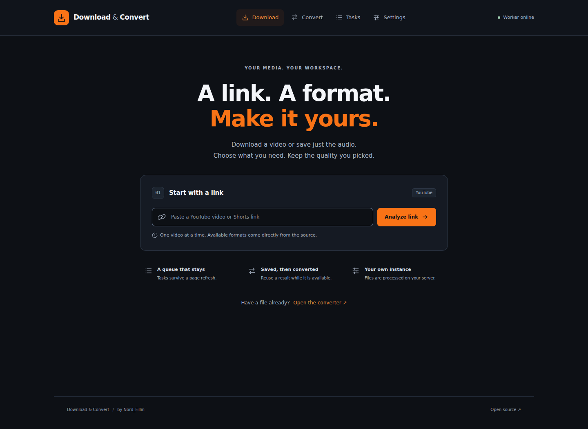
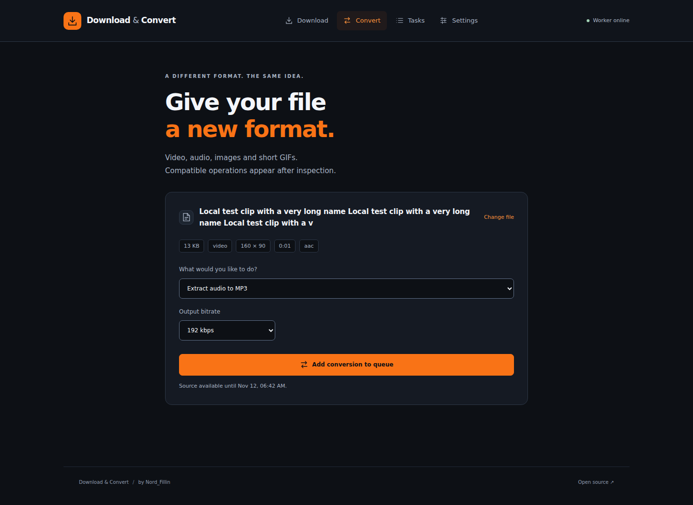
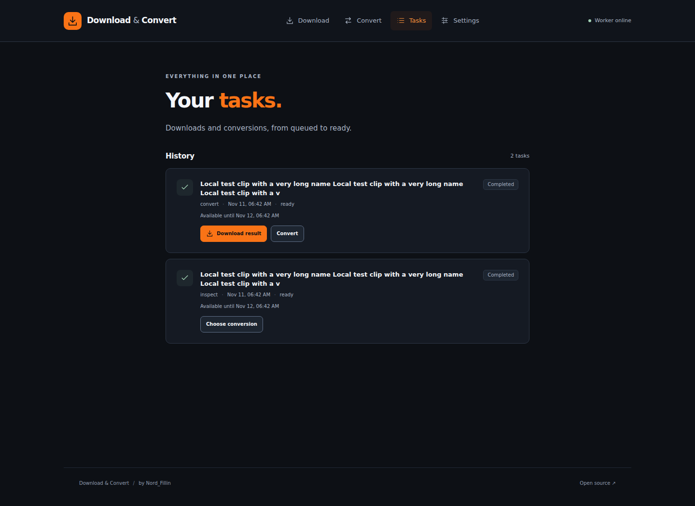
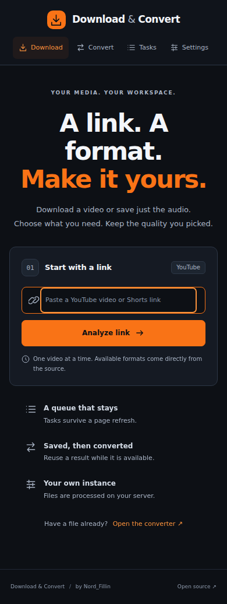
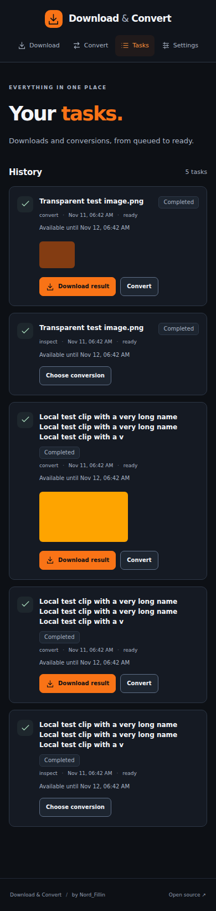

# Download & Convert

A self-hosted media workspace evolving from Nord_Fillin's YouTube Downloader. Vue 3 + TypeScript, FastAPI, a separate worker, yt-dlp, FFmpeg, Pillow and a persistent SQLite queue.

This first slice analyzes an individual YouTube video, binds the choice to actual source formats and queues downloads/MP3 extraction. It also uploads media, inspects contents, converts files and delivers verified results. The complete five-platform target remains in the [specification](docs/media-service/specification.md).

**Verification:** 45 restored backend/media/process tests pass; frontend typecheck, build and formatting pass. GitHub Actions also passed the real desktop/mobile browser scenarios and Docker Compose build/start checks. [Verification evidence](docs/media-service/verification.md) records the checked revisions. Real YouTube metadata analysis passed, but file retrieval returned invalid media in this environment; see the [live report](docs/media-service/live-youtube-2026-11-11.json). The first live download remains a separate acceptance gate.

## Start

```bash
git clone --branch feat/media-platform https://github.com/Denofix/youtube-downloader.git download-convert
cd download-convert
cp .env.example .env
docker compose up --build -d --wait
```

Open **http://localhost:8080**. Both API and worker must run. The named `media-data` volume keeps files and SQLite state. The default listener is loopback for a private owner-operated instance. Public hosting is a separate milestone. On Windows use Docker Desktop; in a Linux VM, view localhost from that VM or use an SSH port forward from the host.

## Screenshots

Actual running interface, captured by the [browser integration run](https://github.com/Denofix/youtube-downloader/actions/runs/42974101607). Conversion/history examples use generated local test media.



<details>
<summary>Conversion, history and mobile layouts</summary>





| Mobile download | Mobile tasks |
| --- | --- |
|  |  |

</details>

## Current features

- Download real source format IDs with resolution/FPS/codecs/audio/size details, track merging and explicit MP3 encoding. Missing formats require fresh analysis; no silent quality fallback.
- Convert compatible MP4/WebM/MKV/MOV, MP3/M4A/WAV/FLAC/OGG, GIF clips, JPG/PNG/WebP and animated GIF to video. Options depend on detected contents and installed encoders.
- Persist queued/running/completed/failed/cancelled tasks, separate operations and real per-operation progress. Cancel, retry, recover after restart, reuse a result and show file expiry.
- Default limits: one processing job, 512 MiB per file, 5 GiB media storage, 30 minutes per task, 24-hour results. Configure owner values in `.env`.
- Graphite/orange Download, Convert, Tasks and Settings pages, keyboard focus/labels, mobile layout and worker diagnostics.

TikTok, SoundCloud, Instagram, Pinterest, photo/carousel selection, ZIP delivery and batch upload UI are planned. The original desktop source, assets, copyright and license remain available; [legacy notes](legacy/README.md) explain the separate dependency lists.

## Architecture

The browser uses the same-origin API. FastAPI streams bounded uploads and persists tasks in SQLite. A separate Linux worker atomically claims one task and runs it in a killable process group. Source/media adapters normalize formats or inspect contents. Only verified results become opaque asset IDs in generated private directories. API and worker share a persistent local volume; no external queue broker is required.

| Path | Purpose |
| --- | --- |
| `backend/service/api.py` | Validated API, diagnostics and compiled frontend |
| `backend/service/worker.py` | Claims, process supervision, cancellation, limits and heartbeat |
| `backend/service/runner.py` | Isolated task execution |
| `backend/service/sources.py` | URL validation, metadata normalization and exact selection |
| `backend/service/media.py` | Content inspection, capabilities, conversion and full decoding |
| `backend/service/store.py` | SQLite tasks/assets, recovery, retention and cleanup |
| `frontend/` | Vue 3 / TypeScript / Vite |
| `tests/`, `scripts/` | Generated fixtures, process/browser checks and opt-in live verification |

## Native Linux development

Install Python 3.12+, uv 0.13.6, Node 24 and FFmpeg/ffprobe. From the repository root:

```bash
uv sync --frozen --all-groups
npm --prefix frontend ci
npm --prefix frontend run build
PYTHONPATH=backend uv run --no-sync uvicorn service.api:app --host 127.0.0.1 --port 8000
```

In another terminal in the same directory:

```bash
PYTHONPATH=backend uv run --no-sync python -m service.worker
```

Open http://localhost:8000. For hot reload, `npm --prefix frontend run dev` proxies `/api` to port 8000. The source-of-truth dependency files are `uv.lock` and `frontend/package-lock.json`; root requirements.txt is a UTF-8 frozen runtime export.

## Verification and operations

```bash
uv run --no-sync ruff check backend tests scripts
uv run --no-sync ruff format --check backend tests scripts
uv run --no-sync pytest -q
npm --prefix frontend run format:check
npm --prefix frontend run build
```

[Operations](docs/media-service/operations.md) covers real browser screenshots, opt-in live tests, owner cookies, trusted certificates, updates, backup and recovery. CI runs the controlled suite and builds the container stack; review actual run results rather than treating the workflow file itself as a pass.

Next gates: real link-to-file YouTube verification and browser/Compose runtime verification. Then expand publication types and sources one at a time. Light theme, batch uploads, subscriptions, channel/profile scanning, media library and public multi-user hosting remain later stages.

## References & Inspiration

[VERT](https://vert.sh/) ([source](https://github.com/VERT-sh/VERT)) — visual clarity and upload area; [MeTube](https://github.com/alexta69/metube) — queue organization; [yt-dlp-web-ui](https://github.com/marcopiovanello/yt-dlp-web-ui) — format selection; [ConvertX](https://github.com/C4illin/ConvertX) — conversion flow; [Parabolic](https://github.com/NickvisionApps/Parabolic) — compact metadata/tasks; [Pinchflat](https://github.com/kieraneglin/pinchflat) — presets and naming.

These are product/design references, not copied source/assets. Unlike VERT's on-device processing, this service processes files on the owner's server.

## Author and license

Created by **Nord_Fillin**. The original [MIT license](LICENSE), attribution and Git history are preserved. Dependency licenses apply separately, including yt-dlp/ejs, Vue, FastAPI, Pillow and the particular FFmpeg build/codecs supplied by the base OS. No reference application's code or visual assets were imported.
