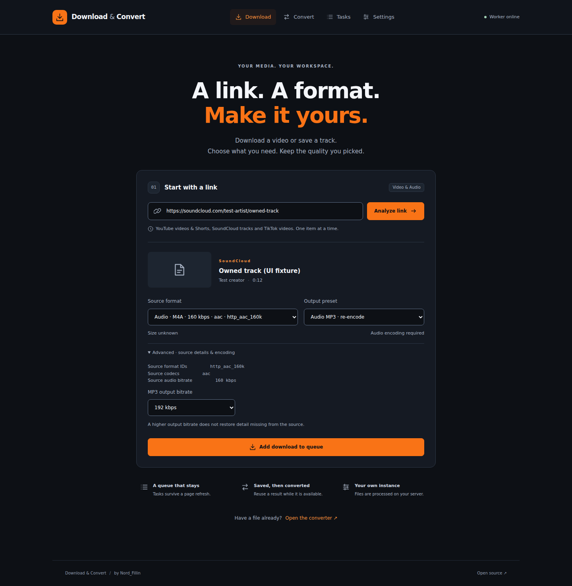
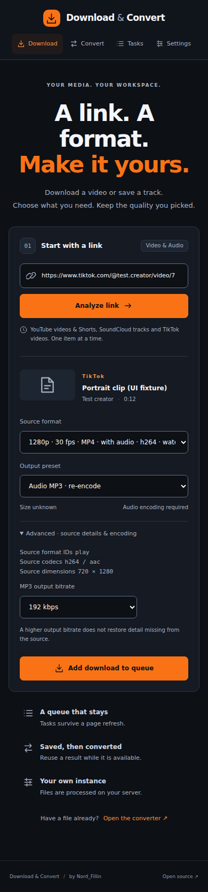

# Stage 2 — SoundCloud tracks and TikTok videos

Branch: `feat/soundcloud-tiktok`, based on the owner-verified `feat/media-platform` commit b1cbfa6200f1036da2b8629a7c8b9785f71a1265. This is a separate change on top of PR #2; no merge of that PR is assumed. No data migration or dependency update is required.

## Implemented behavior

- Public SoundCloud artist/track permalinks and individual TikTok `@creator/video/id` permalinks use the existing persistent analysis/download queue, cancellation, limits, verification and result reuse.
- Common share URLs (`on.soundcloud.com`, `vm.tiktok.com`, `vt.tiktok.com`, `www.tiktok.com/t/...`) resolve inside the worker. Every redirect is validated before a further request; only short-link hosts on the same platform can be followed. The final URL must be an accepted individual permalink. Loops, more than five redirects, foreign/private hosts and collection/photo/live destinations produce an actionable error. Tracking parameters are discarded.
- Only the individual YouTube, SoundCloud and TikTok extractors are loaded. Arbitrary pages, profiles, playlists and user-provided tool arguments remain unavailable.
- Source options expose actual codecs, dimensions, format IDs and available audio bitrate; native select labels distinguish formats with the same resolution/container. No source bitrate or file size is invented.
- SoundCloud preview formats are excluded. Preview-only availability explains that a full track requires different access/material. Original keeps the selected source; MP3 re-encodes explicitly at 128/192/320 kbps.
- TikTok standalone music formats are excluded because they can differ from the clip's audio/duration. MP3 is extracted from the selected video. Video-only variants stay silent. Known unplayable bytevc2 variants are excluded. Extractor-provided watermark notes are displayed; no watermark-removal guarantee is made.
- Portrait dimensions are retained and both width and height are verified against the selected original video. Artwork accepts only HTTPS on a platform-specific CDN allowlist, also reflected in CSP.

## Verification — 11 November 2026

| Check | Result |
| --- | --- |
| Backend/media/process suite | 103 local cases passed, including all previous YouTube/conversion/queue tests |
| New source delivery | API → queue → real yt-dlp → generated local media → FFmpeg verification → HTTP retrieval passed for original and MP3 on both source contracts |
| Boundaries | Canonicalization, safe share redirects, loop/hop rejection, worker-only resolution, preview rejection, TikTok clip/music separation, exact-format failure and incorrect portrait dimensions covered |
| Frontend | Typecheck, production build and formatting passed locally |
| Local browser | Chromium could not launch because this execution environment rejects its AF_UNIX socket; browser/container gates run in GitHub Actions |
| Live SoundCloud | Passed: public 143-second track; exact hls_aac_96k download to M4A (1,744,152 bytes) and MP3 (3,438,901 bytes), both decoded/verified and retrieved with HTTP 200 |
| Live TikTok | Metadata failed with `network_blocked`: the upstream extractor reported that this server's IP is blocked. No live TikTok download is claimed |

The dated [SoundCloud report](live-soundcloud-2026-11-11.json) and [TikTok report](live-tiktok-2026-11-11.json) record tool versions, selected formats and outcomes. The earlier YouTube owner report remains unchanged. The optional live script now supports audio-only tracks as well as videos. Network blocks are surfaced without exposing upstream errors, signed media links, cookies or server paths.

The browser suite adds two source forms with explicitly marked **UI metadata fixtures**: SoundCloud on desktop and portrait TikTok on mobile. It checks unique format labels, MP3 controls and overflow, then continues the real generated-file upload/conversion/download checks. These forms are not live-source evidence.

[GitHub Actions run 43009512299](https://github.com/Denofix/youtube-downloader/actions/runs/43009512299) passed both jobs for source commit 49e5dc8ff55cd52b803b127497fd90adcd9d54d3: 103 tests, frozen dependency/export comparison, frontend checks, the real Chromium scenarios and Docker Compose build/start. Artifact 13848659885 contains seven actual screenshots (ZIP SHA256 269c65f501e69aa0f730db0d397e570ac1aeb602905a9e1fe08720828ed4391e). The two new source screenshots were inspected and preserved below.

<details>
<summary>Source forms from the actual CI browser (metadata fixtures)</summary>





</details>

## Extractor and dependency review

The existing locked yt-dlp 2026.10.26 installation already contains both individual extractors. The reviewed [SoundCloud implementation](https://github.com/yt-dlp/yt-dlp/blob/2026.10.26/yt_dlp/extractor/soundcloud.py) marks preview formats and returns real audio bitrate; the [TikTok implementation](https://github.com/yt-dlp/yt-dlp/blob/2026.10.26/yt_dlp/extractor/tiktok.py) distinguishes video, standalone music and known unplayable codecs. No copied extractor or new dependency is added. yt-dlp's [existing license](https://github.com/yt-dlp/yt-dlp/blob/2026.10.26/LICENSE) is unchanged, as are this project's MIT license and original desktop files. gallery-dl is not needed for these two publication types; photos and carousels require their own later review and implementation.

## Update the existing Windows Compose instance

Run in the existing checkout after checking `git status` for personal edits:

```powershell
git fetch origin
git switch feat/soundcloud-tiktok
docker compose up -d --build
```

Open `http://localhost:8080` and refresh the page. The existing Compose data volume is retained. Check one public SoundCloud track with Original and MP3, then one short public TikTok video with Original and MP3. Download/play both results. Confirm that the TikTok MP3 is the clip's audio rather than an unrelated full soundtrack. If TikTok fails, retain its displayed error code; the live gate remains open until that instance produces a valid file.

On Linux, an optional dated machine-readable check is:

```bash
uv run --no-sync python scripts/verify_live.py "PUBLIC_TRACK_OR_VIDEO_URL" --output live-source.json
```

## Following stage

Complete the TikTok owner-instance live gate, then implement photo publications and carousel item selection/delivery. Instagram/Pinterest, ZIP delivery, batches and subscription/library features remain staged separately.
